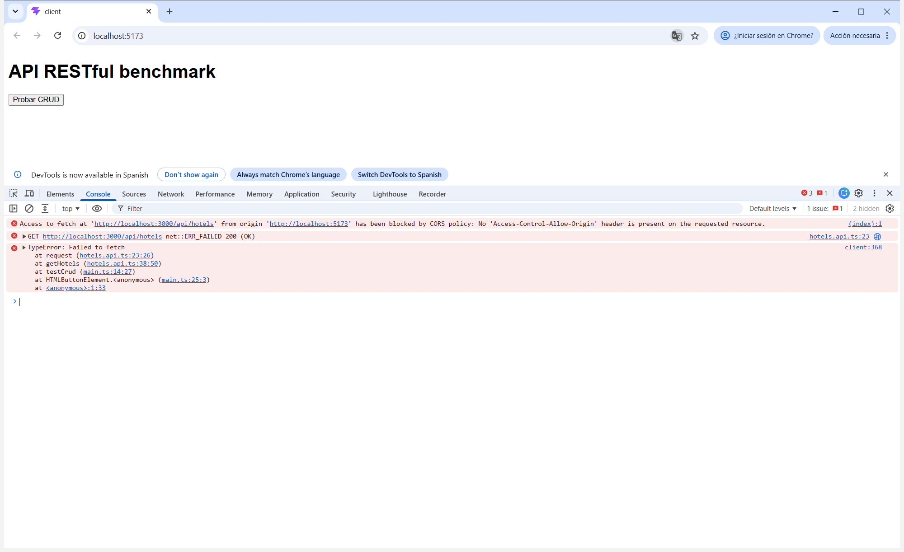
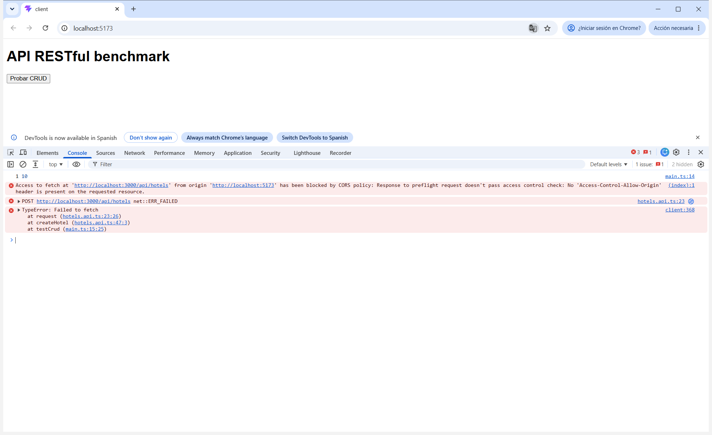
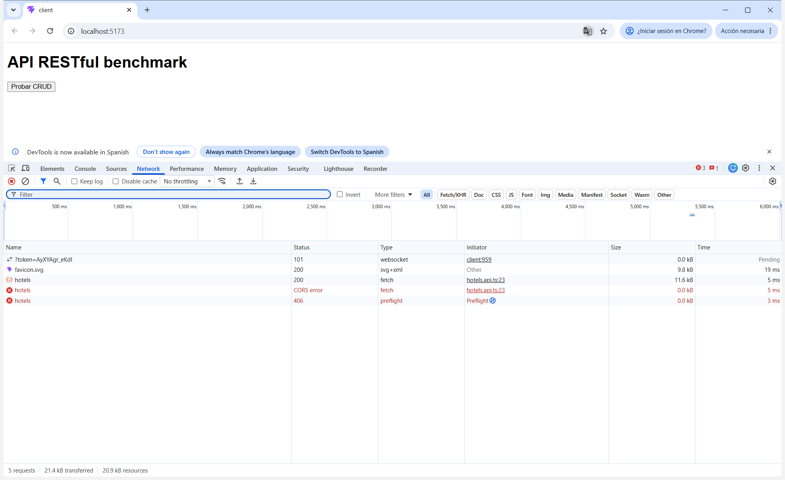
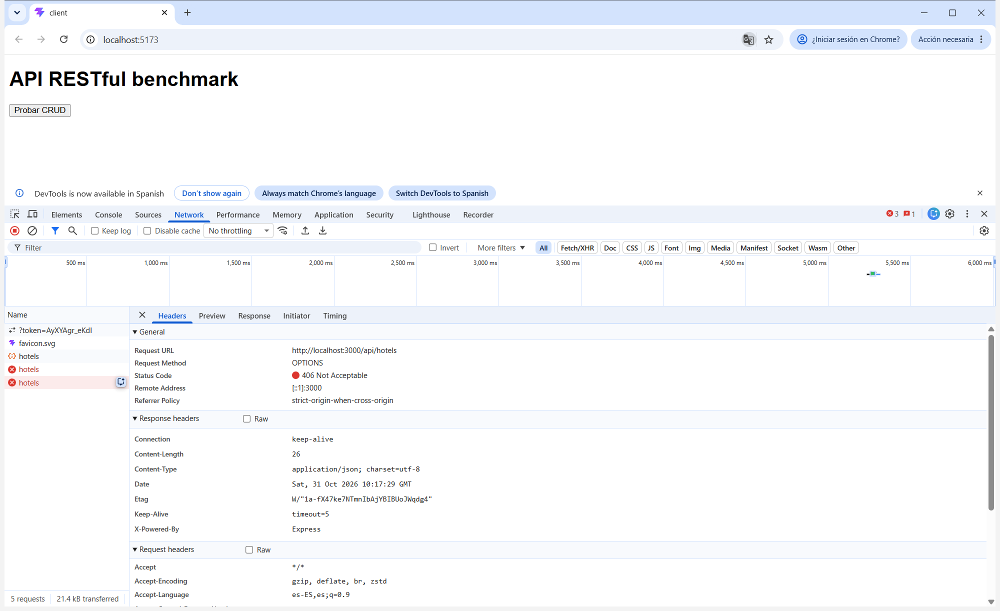
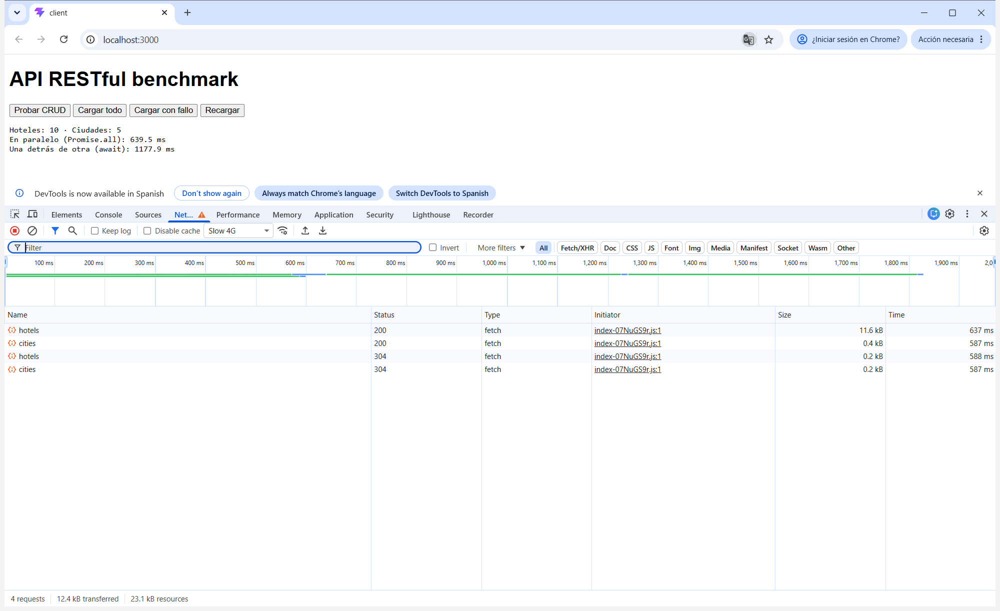
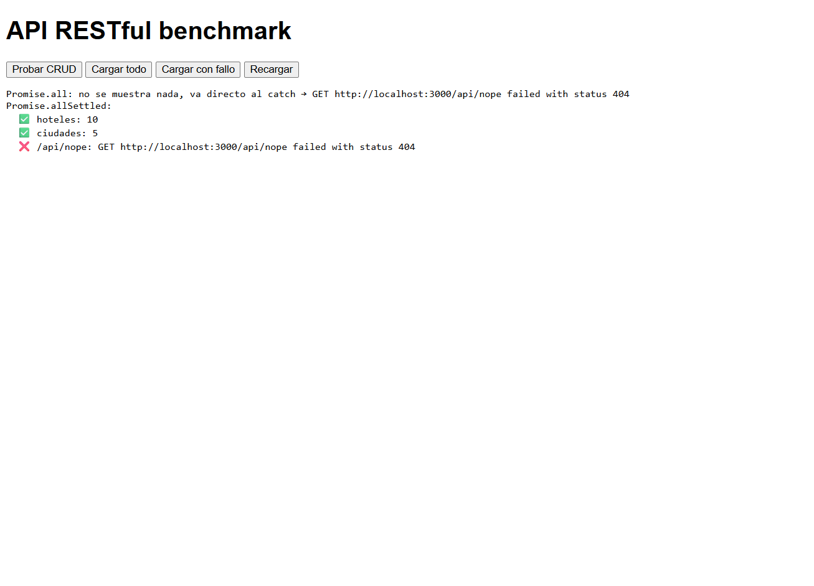
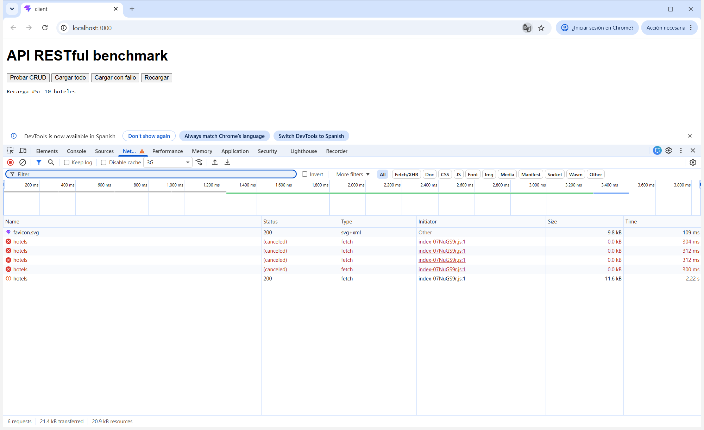

# Laboratorio · Módulo 05 · API REST

Cliente con `fetch` contra el servidor de hoteles (`hotels-server`): exploración de la API, CRUD, CORS y gestión de varias peticiones.

## Cómo arrancarlo

### Servidor

```bash
cd hotels-server
npm install
npm run dev        # http://localhost:3000
```

> Los datos viven en memoria: cada reinicio (también al guardar un fichero del servidor, porque usa `tsx watch`) vuelve a los 10 hoteles iniciales.

### Cliente

El cliente se construye y lo sirve el propio servidor (mismo origen, `http://localhost:3000`):

```bash
cd client
npm install
npm run build      # tsc + vite build; el postbuild copia dist/ a hotels-server/front
```

> Si npm tiene `ignore-scripts=true` (compruébalo con `npm config get ignore-scripts`), el `postbuild` no se ejecuta y hay que copiar a mano: `Copy-Item dist\* ..\hotels-server\front -Recurse -Force` (PowerShell) o `cp -r dist/* ../hotels-server/front/` (bash).

### Cliente en modo desarrollo (otro origen)

La URL base de la API sale de `VITE_API_BASE`, en `client/.env` (Vite solo lee los `.env` de su raíz, `client/`, no los de la raíz del repo):

```
VITE_API_BASE=http://localhost:3000/api
```

```bash
cd client
npm run dev        # http://localhost:5173 → llama a http://localhost:3000/api (otro origen)
```

### Activar CORS

```bash
# macOS / Linux
USE_CORS=yes npm run dev

# Windows (PowerShell)
$env:USE_CORS="yes"; npm run dev
```

> Con `USE_CORS=yes` el servidor sirve estáticos desde `public/` (las miniaturas) en lugar de `front/`, así que el cliente construido ya no está en `http://localhost:3000`: hay que usar el de Vite (5173).

---

## O1 · Explorar la API antes de programar

Peticiones hechas con `curl -i` contra el servidor recién arrancado, en este orden. Por ejemplo:

```bash
curl -i -H "Accept: application/json" http://localhost:3000/api/hotels/1

curl -i -X POST -H "Accept: application/json" -H "Content-Type: application/json" \
  -d '{"name":"Hotel Tueste","city":"Seattle","lowRate":90,"highRate":120}' \
  http://localhost:3000/api/hotels

curl -i -X PUT -H "Accept: application/json" -H "Content-Type: application/json" \
  -d '{"lowRate":42}' http://localhost:3000/api/hotels/1

curl -i -X DELETE -H "Accept: application/json" http://localhost:3000/api/hotels/1
```

| Petición | Código de estado | ¿Qué devuelve en el cuerpo? |
|---|---|---|
| `GET /api/hotels` sin cabecera `Accept` | `406 Not Acceptable` | `{"error":"Not Acceptable"}` |
| `GET /api/hotels` con `Accept: application/json` | `200 OK` | `{"data":[...]}` con los 10 hoteles completos (~30 campos cada uno) |
| `GET /api/hotels/1` | `200 OK` | `{"data":{...}}` con el hotel "Motif Seattle" |
| `GET /api/hotels/999` | `200 OK` ⚠️ | `{}` (vacío, sin `data`) |
| `GET /api/cities` | `200 OK` | `{"data":[{"id":"Seattle","name":"Seattle"}, ...]}` con 5 ciudades |
| `POST /api/hotels` con un hotel en JSON | `201 Created` | `{"data":{...}}` con lo enviado más `id` (UUID generado por el servidor), `created` y `modified` |
| `PUT /api/hotels/1` cambiando `lowRate` | `200 OK` | `{"data":{...}}` con el hotel completo actualizado (nuevo `lowRate` y nuevo `modified`) |
| `DELETE /api/hotels/1` | `204 No Content` | Nada (sin cuerpo ni `Content-Type`) |
| `GET /api/hotels/1` después de borrarlo | `200 OK` ⚠️ | `{}` |

### Comprobaciones

- **Sin `Accept: application/json` todo `/api` falla con 406.** En `hotels-server/src/middleware.ts`, `checkContentTypeJSON` compara la cabecera con `accept !== "application/json"`, una igualdad exacta. Cualquier otro valor (que no venga, `*/*` o `application/json, text/plain, */*`, que es lo que manda axios por defecto) se rechaza. En `index.ts` el middleware está montado sobre todo `/api` con `app.use('/api', checkContentTypeJSON)`.
- **Los datos vienen envueltos** en `{ "data": ... }` en todas las respuestas correctas.
- **Las dos respuestas que no siguen la teoría** (⚠️): `GET /api/hotels/999` y `GET /api/hotels/1` después del `DELETE` deberían devolver `404 Not Found` y devuelven `200 OK` con `{}`. El motivo: `hotelRepo.findById(id)` devuelve `undefined`, y `res.json({ data: undefined })` se serializa como `{}` porque `JSON.stringify` omite las propiedades `undefined`.

### 📝 Respuestas

**¿Qué código debería devolver `GET /api/hotels/999` según el concepto 01? ¿Qué devuelve este servidor? ¿Qué problema le causa eso al front?**

Según "Common HTTP Response Status Codes" debería devolver `404 Not Found`, porque el recurso pedido no existe. Este servidor devuelve `200 OK` con el cuerpo `{}`.

El problema para el front es que, para `fetch`, la petición ha ido bien: `response.ok` es `true`, no se lanza ningún error y el código sigue como si tuviera un hotel. Al leer `body.data` obtiene `undefined`, y el fallo aparece más tarde y lejos de su origen (por ejemplo, `Cannot read properties of undefined (reading 'name')` al pintar). El front no puede fiarse del código de estado para saber si el hotel existe: tiene que inspeccionar el cuerpo (que falte `data`), y eso acopla el cliente a un comportamiento incorrecto del servidor.

**¿Por qué el DELETE no devuelve cuerpo? ¿Qué código lo indica?**

Porque, una vez borrado, no hay recurso que devolver: basta con confirmar que la operación ha ido bien. Lo indica el `204 No Content`, que significa éxito sin cuerpo (tampoco llega `Content-Type`). Por eso el cliente no debe llamar a `response.json()` con un 204: no hay JSON que leer y fallaría con un error de parseo.

**El concepto 02 recomienda envolver las respuestas en un objeto (`{ "data": ... }`). ¿Qué ventaja tiene frente a devolver el array directamente?**

Que la respuesta se puede ampliar sin romper el contrato. Si mañana hace falta paginación o metadatos, basta con añadir propiedades al lado de `data` (`{ "data": [...], "pagination": { ... } }`), y los clientes que ya leían `data` siguen funcionando. Con un array en la raíz no hay dónde añadir nada sin cambiar el tipo de la respuesta, lo que obliga a modificar todos los clientes. Además, todas las respuestas siguen la misma forma (`data` si va bien, `error` si va mal), y eso permite tratarlas de manera uniforme en el cliente.

---

## O2 · Un cliente con fetch

Código en [`client/src/hotels.api.ts`](client/src/hotels.api.ts) y [`client/src/main.ts`](client/src/main.ts).

- **Modelo:** `Hotel` solo tiene los 5 campos que usa el front (`id`, `name`, `city`, `lowRate`, `highRate`), y `NewHotel = Omit<Hotel, "id">`.
- **`request<T>(path, options)`** concentra lo que se repite en todas las llamadas:
  - Añade siempre `Accept: application/json`, y `Content-Type: application/json` solo cuando hay `body`.
  - Si `response.ok` es `false`, lanza `Error("<MÉTODO> <URL> failed with status <código>")`.
  - Con un `204` no lee el cuerpo y devuelve `undefined`.
  - Si no, devuelve `body.data`.
- **`getHotel(id)` devuelve `null` si el hotel no existe.** Como vimos en O1, el servidor responde `200` con `{}` y no un 404. Por eso no se puede detectar con el código de estado: `request` devuelve `body.data`, que es `undefined` cuando falta, y `getHotel` lo convierte en `null` (`hotel ?? null`).
- **Botón "Probar CRUD"** en `main.ts`: ejecuta el recorrido del enunciado, y si algo falla el error se muestra con `console.error`.

### Comprobaciones

Con el cliente servido en `http://localhost:3000`, al pulsar "Probar CRUD" la consola muestra:

```
1 10
2 Hotel Tueste ef4ff351-0a12-4b32-9ab9-85b618cfd567
3 Hotel Tueste
4 95
5 null
6 10
```

En Network (Fetch/XHR) aparecen, en orden: `GET /api/hotels` 200, `POST /api/hotels` **201**, `GET /api/hotels/:id` 200, `PUT /api/hotels/:id` 200, `DELETE /api/hotels/:id` **204**, `GET /api/hotels/:id` 200 y `GET /api/hotels` 200. El Payload del POST es exactamente el JSON enviado: `{"name":"Hotel Tueste","city":"Seattle","lowRate":90,"highRate":120}`, sin `id`.

Al quitar el `Accept` de `request`, la consola muestra `Error: GET /api/hotels failed with status 406` y no un `undefined` silencioso. Como el recorrido es secuencial (`await` tras `await`), la primera petición que falla corta el resto: no llega a hacer el POST.

### 📝 Respuestas

**`fetch` no lanza un error con un 404 o un 500. ¿Cuándo sí lanza? ¿Qué pasaría en vuestra aplicación si no comprobaseis `response.ok`?**

`fetch` solo rechaza la promesa cuando **no hay respuesta HTTP** que entregar:
- un fallo de red (servidor caído, sin conexión, DNS que no resuelve);
- una petición bloqueada por CORS;
- una petición cancelada con un `AbortController` (`AbortError`);
- una URL o unas opciones inválidas.

Si el servidor responde, aunque sea con un 404 o un 500, para `fetch` la petición "ha ido bien": resuelve con un `Response` que tiene `ok === false` y el código en `status`.

Sin comprobar `response.ok`, el código seguiría como si todo hubiera ido bien. Leería el cuerpo de error (por ejemplo `{"error":"Not Acceptable"}` en un 406) y devolvería su `data`, es decir, `undefined`. El fallo saltaría más tarde y lejos de su causa: en nuestro botón, `(await getHotels()).length` daría `TypeError: Cannot read properties of undefined (reading 'length')`, sin ninguna pista de que el problema real era un 406 del servidor.

**¿Por qué `createHotel` no envía el `id`? ¿Quién lo decide?**

Porque el `id` lo decide el **servidor**, que es el dueño del recurso. En `hotel.repo.ts`, `create()` le asigna `crypto.randomUUID()` (además de `created` y `modified`), y lo hace después de copiar los datos recibidos, así que un `id` enviado por el cliente se sobrescribiría igualmente. El cliente no puede garantizar que un identificador sea único entre todos los clientes, y el servidor sí. Por eso el tipo `NewHotel = Omit<Hotel, "id">` impide en tiempo de compilación pasar un `id`, y el cliente lo conoce leyendo la respuesta del `POST` (`201` con el hotel creado).

## O3 · Llamar desde otro origen: CORS

`hotels.api.ts` lee la URL base con `import.meta.env.VITE_API_BASE`. El cliente corre en `http://localhost:5173` (Vite) y la API en `http://localhost:3000`. El puerto es distinto, así que el **origen** es distinto.

### Comprobaciones

**Sin CORS:** al pulsar "Probar CRUD" la consola muestra:

```
Access to fetch at 'http://localhost:3000/api/hotels' from origin 'http://localhost:5173' has been blocked by CORS policy:
No 'Access-Control-Allow-Origin' header is present on the requested resource.
TypeError: Failed to fetch
```

La petición sí llega al servidor: aparece en el log de `morgan`, y repetida con `curl` (con `-H "Origin: http://localhost:5173"`) responde `200 OK` con los hoteles, pero sin ninguna cabecera `Access-Control-Allow-Origin`. La propia consola lo deja ver: `GET http://localhost:3000/api/hotels net::ERR_FAILED 200 (OK)`.



**Con CORS (`USE_CORS=yes`):**

- El primer `GET /api/hotels` funciona (`200`, la consola muestra `1 10`) y entre sus cabeceras de respuesta está `access-control-allow-origin: *`.
- El POST falla. En Network aparece antes un `OPTIONS /api/hotels` que responde **406**, y el POST queda como `net::ERR_FAILED`: nunca se llega a enviar. La consola muestra:

```
Access to fetch at 'http://localhost:3000/api/hotels' from origin 'http://localhost:5173' has been blocked by CORS policy:
Response to preflight request doesn't pass access control check: No 'Access-Control-Allow-Origin' header is present on the requested resource.
```







Cabeceras de esa petición `OPTIONS` (preflight):

| Petición | Respuesta (406) |
|---|---|
| `accept: */*`<br>`access-control-request-method: POST`<br>`access-control-request-headers: content-type`<br>`origin: http://localhost:5173` | `content-type: application/json`<br>Sin ninguna cabecera `access-control-allow-*` |

### 📝 Respuestas

**¿Quién bloquea la respuesta en la comprobación 1: el servidor o el navegador? ¿Por qué `curl` no tenía este problema en O1?**

El **navegador**. El servidor recibe la petición, la procesa y responde `200` con los datos: se ve en su log y repitiéndola con `curl`. Lo que pasa es que la respuesta no trae `Access-Control-Allow-Origin`. Por la política del mismo origen, el navegador no deja que el JavaScript de `http://localhost:5173` lea una respuesta de `http://localhost:3000` si el servidor no lo autoriza explícitamente, así que descarta la respuesta y hace que `fetch` rechace con `TypeError: Failed to fetch`.

`curl` no es un navegador: no ejecuta código de terceros ni tiene un "origen" que proteger, así que no aplica CORS. Muestra la respuesta tal cual. CORS no protege al servidor; protege al usuario del navegador, para que una página no lea con sus credenciales datos de otro sitio.

**¿Por qué el GET no necesita esa petición `OPTIONS` y el POST sí?**

Porque el GET es una **petición simple**: usa el método `GET` y solo cabeceras de la lista segura (`Accept` lo es). El navegador la envía directamente y después comprueba `Access-Control-Allow-Origin` en la respuesta.

El POST lleva `Content-Type: application/json`. `Content-Type` solo cuenta como cabecera segura con `text/plain`, `multipart/form-data` o `application/x-www-form-urlencoded`. Con `application/json`, el navegador primero pregunta al servidor con un **preflight**: un `OPTIONS` al mismo endpoint con `Access-Control-Request-Method: POST` y `Access-Control-Request-Headers: content-type`. Solo si el servidor responde que lo permite (`Access-Control-Allow-Origin`, `-Methods` y `-Headers`) se envía el POST de verdad.

**Explicad el error del POST. ¿Por qué responde 406 a la petición `OPTIONS`?**

El error dice *"Response to preflight request doesn't pass access control check: No 'Access-Control-Allow-Origin' header is present"*. El problema no está en el POST, que ni se llega a enviar, sino en la respuesta al **preflight**: no trae las cabeceras CORS, así que el navegador considera que el servidor no autoriza la petición y la cancela.

El motivo está en el **orden de los middlewares** de `hotels-server/src/index.ts`:

```ts
app.use('/api', checkContentTypeJSON);   // 1º: exige Accept: application/json
...
app.use("/api", cors());                 // 2º: añade las cabeceras CORS y responde los OPTIONS
```

El preflight lo construye el navegador, que envía `Accept: */*`; nuestro código no puede añadirle cabeceras. `checkContentTypeJSON` (en `middleware.ts`) se ejecuta antes, ve que `Accept` no es exactamente `application/json` y responde `406` sin llamar a `next()`. Por eso `cors()` nunca llega a ejecutarse: ni añade `Access-Control-Allow-Origin` ni responde al `OPTIONS`. El GET funciona porque sí lleva `Accept: application/json`, así que pasa el primer middleware y llega a `cors()`. La solución (desafío D1) sería registrar `cors()` antes de la comprobación del `Accept`, o hacer que esa comprobación deje pasar las peticiones `OPTIONS`.

## O4 · Gestionar varias peticiones

Servidor sin CORS y cliente construido y servido desde `http://localhost:3000` (modo de O2). Hay tres botones nuevos en [`client/src/main.ts`](client/src/main.ts) que pintan el resultado en un `<pre>`. En `hotels.api.ts` se ha añadido:

- `getCities()`;
- un `signal` opcional en `getHotels(signal?)`;
- `export` en `request`, para pedir `/nope` pasando por la misma comprobación de `response.ok`.

- **Cargar todo:** pide hoteles y ciudades con `Promise.all([getHotels(), getCities()])` y luego lo mismo con dos `await` seguidos. Mide los dos casos con `performance.now()`.
- **Cargar con fallo:** añade `request('/nope')`, primero con `Promise.all` y después con `Promise.allSettled`, y muestra cuáles han ido bien y cuáles no.
- **Recargar:** antes de pedir los hoteles, aborta la petición anterior (`reloadController?.abort()`) y crea un `AbortController` nuevo. Si la petición termina con un `AbortError`, se ignora (`return`), porque la cancelación la hemos provocado nosotros. Cualquier otro error se muestra.

### Comprobaciones

**Cargar todo.** En `localhost`, sin limitar la red, la diferencia no se aprecia (unos 20–25 ms en los dos casos, e incluso gana a veces la secuencial porque va segunda): no hay latencia que solapar. Con la red en **Slow 4G**:

| | Tiempo |
|---|---|
| En paralelo (`Promise.all`) | ~595–640 ms (lo que tarda **la más lenta**) |
| Una detrás de otra (`await`) | ~1180 ms (la **suma** de las dos) |

En Network, las dos primeras peticiones (`hotels` y `cities`) empiezan a la vez y sus barras se solapan. En la versión secuencial, `cities` no empieza hasta que acaba `hotels`. Los `304` de la segunda tanda son la caché HTTP (el servidor manda `ETag`).



**Cargar con fallo.** `/api/nope` pasa el middleware del `Accept`, pero no hay ninguna ruta para ella y Express responde `404`. Con `Promise.all` no se muestra ningún resultado: en cuanto una promesa rechaza, `Promise.all` rechaza entera y se va al `catch`, aunque hoteles y ciudades hayan llegado bien. Con `Promise.allSettled` se ven las tres:

```
Promise.all: no se muestra nada, va directo al catch → GET http://localhost:3000/api/nope failed with status 404
Promise.allSettled:
  ✅ hoteles: 10
  ✅ ciudades: 5
  ❌ /api/nope: GET http://localhost:3000/api/nope failed with status 404
```



**Recargar.** Con la red en **3G** y cinco clics seguidos, las cuatro primeras peticiones aparecen como **`(canceled)`** y solo la última termina con `200`. En la página solo se pinta `Recarga #5: 10 hoteles` y en la consola no aparece ningún error.



### 📝 Respuestas

**En una pantalla que necesita hoteles y ciudades para funcionar, ¿usaríais `Promise.all` o `Promise.allSettled`? ¿Y en un panel con varios bloques independientes (el tiempo, las noticias, la bolsa)?**

- **Pantalla que necesita hoteles y ciudades: `Promise.all`.** Si falta cualquiera de los dos datos, la pantalla no puede funcionar, así que tiene sentido el "todo o nada": `Promise.all` falla en cuanto falla una de las peticiones y basta con un único `catch` que muestre un error para toda la pantalla. Con `allSettled` habría que comprobar resultado por resultado para acabar mostrando ese mismo error.
- **Panel de bloques independientes: `Promise.allSettled`.** Que falle la bolsa no debe impedir mostrar el tiempo y las noticias. `allSettled` espera a todas y devuelve el estado de cada una, de modo que cada bloque pinta sus datos o su propio mensaje de error.

**¿Dónde habéis usado ya un `AbortController` en este curso? (Laboratorio 4, O3). ¿Para qué servía allí?**

En el laboratorio 4 (O3, "Cargar los cafés con useEffect") se usó en el `useEffect` que carga los cafés, en `core/coffees/hooks.ts`. El efecto crea un `AbortController`, pasa su `signal` a `getCoffees` y devuelve `() => controller.abort()` como **función de limpieza**. Allí servía para **cancelar la petición cuando el componente se desmonta**, para que su respuesta no actualizase el estado de un componente que ya no está en pantalla. Por eso antes de llamar a `setError` o `setLoading` se comprueba `controller.signal.aborted`. En desarrollo se veía en Network una primera petición `(canceled)`, porque StrictMode monta, desmonta y vuelve a montar el componente a propósito.

Aquí la idea es la misma, pero lo que provoca la cancelación cambia. Allí la provocaba React al desmontar; aquí la provoca un clic nuevo en "Recargar". En los dos casos sirve para **descartar una petición cuya respuesta ya no interesa**. Así se evita una carrera: si la respuesta antigua llegase después de la nueva, pintaría datos viejos encima de los actuales. También en los dos casos la cancelación no se trata como un error: allí se comprueba `signal.aborted` y aquí se ignora el `AbortError`. `abort()` hace que el `fetch` rechace y el navegador corta la conexión, por eso aparece como `(canceled)` en Network.

---

## Checklist

### Obligatorios

- [x] O1 · Explorar la API antes de programar
- [x] O2 · Un cliente con fetch
- [x] O3 · Llamar desde otro origen: CORS
- [x] O4 · Gestionar varias peticiones
- [ ] O5 · README + bitácora de IA (capturas incluidas)

### Opcionales

- [ ] P1 · Lo mismo con axios
- [ ] P2 · El proxy de Vite
- [ ] P3 · El ejercicio del módulo: client-cors
- [ ] P4 · Tueste, con API de verdad
- [ ] P5 · Validar lo que llega

### Desafíos

- [ ] D1 · Arreglad el servidor
- [ ] D2 · Tiempo máximo y reintentos
- [ ] D3 · Diseñad la API de Tueste

---

## 🤖 Bitácora de IA

Herramienta: Claude Code.

_Pendiente: al menos 3 ejemplos con el formato Prompt / Qué me dio / Qué corregí y por qué._
